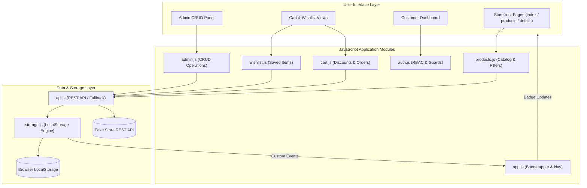

# ShopSphere — Production E-Commerce Web Application

[](https://opensource.org/licenses/MIT)
[](https://developer.mozilla.org/en-US/docs/Web/JavaScript)
[](https://www.w3.org/WAI/standards-guidelines/wcag/)
[](https://developer.mozilla.org/en-US/docs/Web/CSS)
[](https://fakestoreapi.com/)

**ShopSphere** is an e-commerce storefront and store management application built with modern HTML5, CSS3, and modular Vanilla ES6+ JavaScript. Designed as a real-world production portfolio capstone, it includes instant search, multi-facet filtering, responsive design, WCAG 2.1 AA accessibility compliance, role-based simulated authentication, order history tracking, and an admin suite with full CRUD operations and live analytics.

---

## Table of Contents

- [Project Overview](#project-overview)
- [Key Features](#key-features)
- [Live Demo & Quick Evaluation Accounts](#live-demo--quick-evaluation-accounts)
- [Architecture & Data Flow](#architecture--data-flow)
- [Technology Stack](#technology-stack)
- [Folder Structure](#folder-structure)
- [REST API Integration](#rest-api-integration)
- [State Management & Persistence](#state-management--persistence)
- [Simulated Authentication & Role Guarding](#simulated-authentication--role-guarding)
- [Admin Management Suite (CRUD)](#admin-management-suite-crud)
- [Accessibility (WCAG 2.1 AA)](#accessibility-wcag-21-aa)
- [Responsive Design](#responsive-design)
- [Installation & Local Development](#installation--local-development)
- [Deployment Guide](#deployment-guide)
- [Known Limitations](#known-limitations)
- [Future Improvements](#future-improvements)
- [License](#license)
- [Author](#author)

---

## Project Overview

ShopSphere delivers an enterprise-grade shopping experience without relying on third-party frontend frameworks like React or Vue. By using modern browser capabilities—such as Native HTML5 `<dialog>` modals, CSS custom property design tokens, and modular ES6 imports—ShopSphere demonstrates that vanilla JavaScript can power high-performance, maintainable, and accessible web applications.

### Core Problems Solved:
1. **Zero Framework Bloat**: Fast initial page load with minimal JavaScript overhead and zero external dependencies.
2. **Offline & Network Resilience**: Automatically synchronizes with [Fake Store API](https://fakestoreapi.com/) when connected and gracefully fails over to cached seed datasets if the remote API experiences latency or downtime.
3. **True Reactive Multi-Page Synchronization**: State mutations (cart counts, wishlist toggles, stock adjustments) broadcast across tabs and views without full page reloads using browser Custom Events.
4. **Complete E-Commerce Lifecycle**: From product discovery and search to cart management, promo discounts, simulated checkout, order receipt generation, and customer order history tracking.

---

## Key Features

### 🛍️ Customer Storefront
* **Dynamic Catalog**: Browse 20+ products across 4 categories (Electronics, Jewelry, Men's Clothing, Women's Clothing).
* **Instant Real-Time Search**: Debounced search query parsing titles, descriptions, and category metadata.
* **Multi-Facet Refinements**: Filter simultaneously by Category, Maximum Price ($5–$1,000 range slider), and Minimum Rating (3★+, 4★+, 4.5★+).
* **Multi-Criteria Sorting**: Sort instantly by Price (Low→High, High→Low), Rating (High→Low), and Alphabetical (A→Z, Z→A).
* **Detailed Product Inspection**: High-resolution image zoom, stock level indicator (green/amber/red), review counters, dynamic stock-bounded quantity steppers, and related products carousel.
* **Interactive Shopping Cart**: Unit prices, dynamic quantity adjusters, item removal, accessible clear-cart confirmation, and sticky order summary.
* **Voucher & Coupon Engine**: Built-in support for promo codes (`SAVE10` for 10% off, `WELCOME20` for 20% off, `FREESHIP` for free shipping).
* **Simulated Checkout Flow**: Complete checkout modal with shipping address inputs, payment method selection (Mock Credit Card / Cash On Delivery), and order receipt modal.
* **Persistent Wishlist**: 1-click heart toggle on any product card, "Move to Cart", and "Move All to Cart" batch actions.

### 👤 Customer Dashboard
* **Profile Overview**: Avatar, contact info, lifetime spend, and account join date.
* **Order History & Tracking**: Real-time status badges (`Processing`, `In Transit`, `Delivered`), order ID tracking, item thumbnail summaries, and 1-click "Re-order All Items".
* **Address Book**: Update and persist default delivery addresses in LocalStorage.

### 🛠️ Admin Management Suite
* **Real-time Analytics KPIs**: Total Products, Active Categories, Average Price, Low-Stock Alerts (`< 5`), Lifetime Revenue, and Total Orders.
* **Category Breakdown Chart**: Dynamic visual progress bars showing inventory share per category.
* **Product Inventory Table**: Searchable, categorizable table displaying ID, photo thumbnail, stock badges, rating, and actions.
* **Complete CRUD Engine**:
  - **Create**: Add new products with title, category, price, stock, rating, image URL, and description.
  - **Read**: Live rendering of product catalog with stock status pills.
  - **Update**: Modal pre-populated with existing product data for instant edits.
  - **Delete**: Accessible confirmation modal ensuring safe removal from inventory.

---

## Live Demo & Quick Evaluation Accounts

For quick grading and review, ShopSphere provides pre-seeded accounts and 1-click login buttons on the Sign In page:

| Role | Email | Password | Permissions |
| :--- | :--- | :--- | :--- |
| **Administrator** | `admin@shopsphere.com` | `Password@123` | Full Storefront + Admin CRUD Suite (`admin.html`) |
| **Customer** | `demo@shopsphere.com` | `Password@123` | Storefront + Cart + Wishlist + Dashboard (`dashboard.html`) |

> [!TIP]
> On `login.html`, click **"Demo Admin"** or **"Demo Customer"** to log in with a single click.

---

## Architecture & Data Flow

ShopSphere follows a unidirectional state flow paired with a centralized storage engine and reactive event bus:



### Unidirectional Data Flow Cycle:
1. **User Action**: User filters catalog, adds item to cart, edits stock in admin, or places an order.
2. **State Mutation**: Specialized module executes logic, validates inputs, and mutates state via `js/storage.js`.
3. **Persistence**: State is serialized and committed to `localStorage`.
4. **Event Broadcast**: `emitStorageEvent()` dispatches custom DOM events (e.g. `shopsphere:cart-updated`).
5. **UI Re-render**: Subscribers intercept events and update badge counters, product tables, and totals without page reloads.

---

## Technology Stack

* **Markup**: Semantic HTML5 (`<header>`, `<nav>`, `<main>`, `<section>`, `<article>`, `<aside>`, `<footer>`, `<dialog>`)
* **Styling**: Modern CSS3 (CSS Grid, Flexbox, CSS Custom Properties / Tokens, `:focus-visible`, `@keyframes`)
* **Scripting**: Modern Vanilla JavaScript (ES6+ Modules, Async/Await, Fetch API, Object/Array destructuring, Spread/Rest operators)
* **Storage**: Browser LocalStorage & SessionStorage API
* **External API**: [Fake Store API](https://fakestoreapi.com/)
* **Tooling**: Git, Node.js (for local verification)

---

## Folder Structure

```
shopsphere/
├── index.html                  # Landing page (Hero, Categories, Featured, Deals)
├── products.html               # Product catalog (Search, Filters, Sort, Grid, Pagination)
├── product-details.html        # Detailed product view (Gallery, Specs, Stock, Related)
├── cart.html                   # Cart management, coupon codes, tax/shipping, Checkout Modal
├── wishlist.html               # Wishlist items, Move-to-Cart, Remove
├── login.html                  # Simulated login, 1-click demo logins (Customer/Admin)
├── register.html               # Account registration, role selection, validation
├── dashboard.html              # Customer dashboard, order history tracking, profile settings
├── admin.html                  # Admin management (Stats, Category analytics, Product CRUD)
│
├── css/
│   ├── style.css               # Design tokens, reset, typography, header, footer, skip-links
│   ├── components.css          # Cards, buttons, forms, tables, modals, toasts, skeletons, badges
│   └── responsive.css          # Breakpoints (desktop, tablet, mobile), mobile drawer
│
├── js/
│   ├── app.js                  # Global bootstrapper: navbar badges, mobile drawer, auth status
│   ├── api.js                  # REST API communication with timeout, retry, and fallback cache
│   ├── storage.js              # Centralized LocalStorage manager (state, cart, wishlist, orders)
│   ├── auth.js                 # Authentication, session tokens, role authorization & route guards
│   ├── validation.js           # Form validators, input sanitization (XSS prevention), formatters
│   ├── ui.js                   # Accessible modals (<dialog>), toast alerts, rating stars, skeletons
│   ├── products.js             # Catalog rendering, multi-facet filtering, search, sorting, pagination
│   ├── cart.js                 # Cart operations, quantity limits, coupon calculation, checkout
│   ├── wishlist.js             # Wishlist management and synchronization
│   ├── dashboard.js            # User profile management and order history rendering
│   └── admin.js                # Admin CRUD operations, form submissions, analytics calculation
│
├── assets/
│   ├── icons/                  # SVG icons
│   └── images/                 # Image assets
│
├── README.md                   # Comprehensive documentation
└── .gitignore                  # Standard web gitignore
```

---

## REST API Integration

The API module (`js/api.js`) provides standard async functions:

```javascript
getProducts();           // Fetches remote catalog and merges local modifications
getProductById(id);      // Fetches individual product by numeric ID
getCategories();         // Fetches categories list
createProduct(product);  // Simulates POST request and commits to state
updateProduct(id, data); // Simulates PUT request and updates inventory
deleteProduct(id);       // Simulates DELETE request and removes item
```

### Resilient Error & Loading Strategy:
- **Timeout Trap**: Uses `AbortController` with a 6-second threshold to prevent hanging requests.
- **Graceful Fallback**: If FakeStoreAPI is slow, unreachable, or returns HTTP 5xx, the application silently loads high-quality cached seed data from `localStorage`.
- **Zero Uncaught Errors**: Every network interaction is wrapped in try/catch blocks with user-friendly toast alerts.

---

## State Management & Persistence

All application state is preserved across browser refreshes and tab navigations:

| State Entity | Key | Description |
| :--- | :--- | :--- |
| **Catalog** | `shopsphere_products_v1` | Seed items + API data + Admin-created custom products |
| **Cart** | `shopsphere_cart_v1` | Active shopping cart items, selected quantities, and max stock bounds |
| **Wishlist** | `shopsphere_wishlist_v1` | Saved customer favorites |
| **Users** | `shopsphere_users_v1` | Registered customer and admin accounts |
| **Session** | `shopsphere_session_v1` | Currently authenticated user token and role |
| **Orders** | `shopsphere_orders_v1` | Customer order history, invoice totals, and shipment tracking |

---

## Simulated Authentication & Role Guarding

> [!WARNING]
> **Educational Simulation Notice**: Authentication in ShopSphere is designed to demonstrate frontend authentication workflows (form validation, state persistence, route guarding, and role-based UI conditional rendering). Passwords stored in LocalStorage are for simulation and testing purposes only.

### Route Guard Example (`js/auth.js`):
```javascript
// Protects admin.html from unauthorized customer access
export function requireAuth({ adminOnly = false, redirectUrl = 'login.html' } = {}) {
  const user = getCurrentUser();
  if (!user) {
    sessionStorage.setItem('shopsphere_redirect', window.location.pathname + window.location.search);
    window.location.href = `${redirectUrl}?reason=unauthenticated`;
    return null;
  }
  if (adminOnly && user.role !== 'admin') {
    alert('Access restricted to Administrators. Redirecting to your dashboard.');
    window.location.href = 'dashboard.html';
    return null;
  }
  return user;
}
```

---

## Admin Management Suite (CRUD)

Admin users can manage the product catalog in real time:

1. **Create (C)**: Click "Add New Product" to launch an accessible modal dialog. Input title, category, price, stock, rating, image URL, and description. Form validates inputs before insertion.
2. **Read (R)**: Displays an interactive table with thumbnails, price formatters, rating stars, and color-coded stock badges. Includes live keyword search and category filtering.
3. **Update (U)**: Click "Edit" on any row to open the modal pre-filled with the current product's details. Edits immediately reflect in the table and the customer catalog.
4. **Delete (D)**: Click "Delete" to launch a safety confirmation dialog. Confirming removes the item from the catalog and updates all analytics metrics.

---

## Accessibility (WCAG 2.1 AA)

ShopSphere was built from the ground up with digital accessibility in mind:

- **Semantic HTML5**: Replaced generic `div`s with semantic landmarks (`header`, `nav`, `main`, `section`, `article`, `aside`, `footer`, `dialog`).
- **Keyboard Navigation**: Full tab index flow through cards, steppers, buttons, and navigation links.
- **Visible Focus States**: Custom `:focus-visible` ring across all interactive controls.
- **Accessible Modals**: Native HTML5 `<dialog>` elements with backdrop trapping and `Escape` key close handlers.
- **Screen Reader Announcements**: Live `aria-live="polite"` region for toast messages.
- **Form Association**: All inputs have explicit `<label for="...">` bindings with `aria-describedby` error descriptions.
- **Color Contrast**: All text elements meet or exceed WCAG AA contrast ratio of 4.5:1.
- **Skip Link**: Includes `#main-content` skip link for keyboard users.

---

## Responsive Design

Tested and optimized across desktop, tablet, and mobile displays:

* **Desktop (`> 1024px`)**: Full sidebar filter layout, 4-column product grid, horizontal order summary.
* **Tablet (`768px – 1024px`)**: 2-column or 3-column product grid, collapsible category tabs, compact admin statistics.
* **Mobile (`< 768px`)**:
  - Desktop nav links collapse into an animated off-canvas side drawer.
  - App-style fixed mobile bottom navigation bar (Home, Shop, Wishlist, Cart, Account) with live badge counters.
  - 1-column or 2-column responsive product cards.
  - Filter sidebar transforms into an on-demand modal sheet.

---

## Installation & Local Development

No Node build steps, Webpack, or Babel required. Run directly in any modern browser:

### 1. Clone the repository
```bash
git clone https://github.com/YOUR_USERNAME/shopsphere.git
cd shopsphere
```

### 2. Launch with a local HTTP server
Because ShopSphere uses native ES6 JavaScript modules (`type="module"`), files must be served over HTTP/HTTPS rather than `file://`.

**Option A: Using Node.js (Built-in)**
```bash
npx serve .
# or
node -e "const http=require('http'),fs=require('fs'),p=require('path'),m={'.html':'text/html','.js':'text/javascript','.css':'text/css'};http.createServer((q,s)=>{let f=p.join(__dirname,q.url==='/'?'index.html':q.url.split('?')[0]);fs.readFile(f,(e,c)=>{if(e){s.writeHead(404);s.end('Not Found')}else{s.writeHead(200,{'Content-Type':m[p.extname(f)]||'text/plain'});s.end(c)}})}).listen(8080,()=>console.log('Serving on http://localhost:8080'))"
```

**Option B: Using Python 3**
```bash
python -m http.server 8080
```

**Option C: VS Code Live Server**
Right-click `index.html` and select **"Open with Live Server"**.

Open your browser and navigate to:
```text
http://localhost:8080
```

---

## Deployment Guide

Deploy ShopSphere instantly to any static hosting service:

### Deploying to Vercel
1. Install Vercel CLI: `npm i -g vercel`
2. Run `vercel` inside the `shopsphere` folder.
3. Select defaults and deploy.

### Deploying to Netlify
1. Drag and drop the `shopsphere` folder into [Netlify Drop](https://app.netlify.com/drop).
2. Or link your GitHub repository and set the publish directory to `.`.

### Deploying to GitHub Pages
1. Push the code to your GitHub repository:
   ```bash
   git add .
   git commit -m "feat: complete ShopSphere production e-commerce application"
   git branch -M main
   git remote add origin https://github.com/YOUR_USERNAME/shopsphere.git
   git push -u origin main
   ```
2. Navigate to **Settings > Pages** in your GitHub repository.
3. Select `Deploy from a branch`, choose `main`, `/ (root)`, and click **Save**.

---

## Known Limitations

1. **Client-Side Persistence**: Data (new products, orders, cart) is stored in the browser's LocalStorage. Clearing browser data resets state to default seeds.
2. **Fake Store API Server Updates**: The public Fake Store API allows simulated `POST`, `PUT`, and `DELETE` calls, but does not persist new records on their live servers. ShopSphere mirrors these mutations inside LocalStorage to provide a complete persistence layer.
3. **Simulated Payment Gateway**: No real card transactions take place; orders are confirmed instantly in demo mode.

---

## Future Improvements

* [ ] Dark mode toggle with `prefers-color-scheme` synchronization.
* [ ] Multi-currency converter (USD, EUR, GBP, JPY).
* [ ] IndexedDB caching layer for offline offline storage of high-resolution images.
* [ ] WebShare API integration for sharing product links.

---

## License

This project is licensed under the **MIT License** — see the [LICENSE](LICENSE) file for details.

---

## Author

Crafted with care as a **Production Capstone Portfolio Project**.
Feel free to star ⭐ the repository if you found this implementation helpful!
